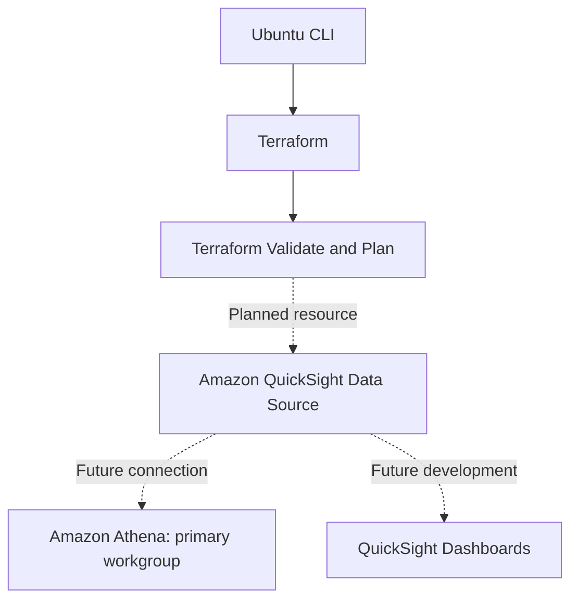

# Amazon QuickSight Terraform Lab

## Project Overview

This project demonstrates how to use Terraform to plan
an Amazon QuickSight data source connected to Amazon Athena.

The project is part of an 11-module AWS Cloud Engineering
hands-on learning portfolio.

**Status: PLAN ONLY — NOT DEPLOYED**

## Architecture



The diagram represents planned infrastructure only.
No QuickSight data source or dashboard was deployed.

## Technologies

- Amazon QuickSight
- Amazon Athena
- Terraform
- AWS CLI
- Ubuntu Linux
- Git and GitHub

## Planned Resource

| Resource | Purpose | Status |
|---|---|---|
| aws_quicksight_data_source.athena | Connect QuickSight to Athena | Planned |

## Configuration

- AWS Region: us-east-1
- Data source ID: terraform-athena-source
- Data source name: Terraform Athena Data Source
- Data source type: ATHENA
- Athena workgroup: primary

## AWS Discovery

Read-only AWS CLI discovery returned:

- QuickSight subscription: ResourceNotFoundException
- QuickSight datasets: empty list
- QuickSight dashboards: UnsupportedUserEditionException

The account was not subscribed to QuickSight.

## Terraform Validation

Commands:

```bash
terraform init
terraform fmt -check
terraform validate
terraform plan -refresh=false -input=false -no-color
```

Observed results:

```text
Success! The configuration is valid.

Plan: 1 to add, 0 to change, 0 to destroy.
```

## Deployment Status

No terraform apply was executed.

No QuickSight subscription was activated.

No QuickSight data source or dashboard was deployed.

The Terraform plan does not guarantee successful deployment
without an active QuickSight subscription.

## Security and Cost

- No AWS credentials or private keys should be committed.
- Terraform state files are excluded from Git.
- QuickSight subscriptions and users may incur charges.
- Athena queries may incur charges.
- No paid QuickSight resources were activated.

## Future Improvements

- Review QuickSight subscription requirements and pricing.
- Activate a subscription only after explicit authorization.
- Configure appropriate IAM permissions.
- Connect QuickSight to Athena.
- Create datasets and dashboards.
- Validate access controls and cost monitoring.

## Validation Evidence

See:

- docs/validation-evidence.md
- screenshots/quicksight-terraform-validation.png
